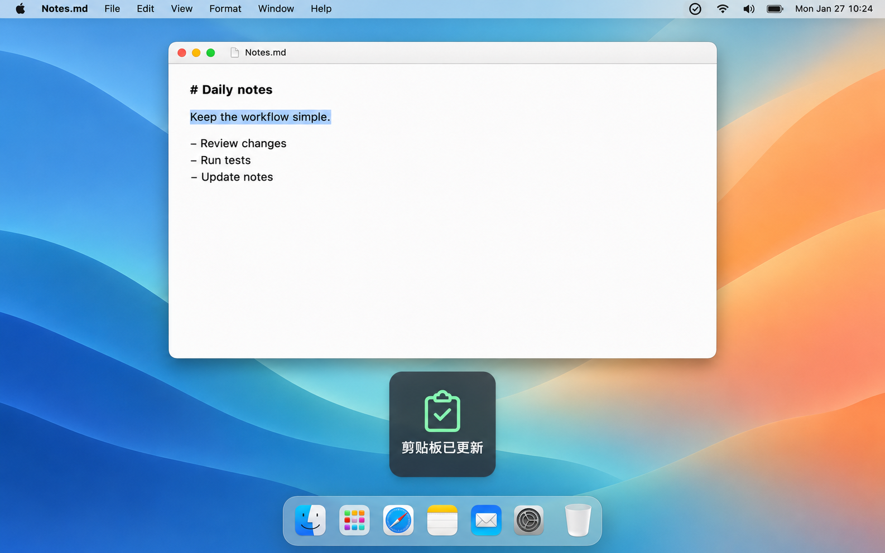

# Cuewink


Cuewink 是一款原生 macOS 菜单栏工具，为剪贴板更新和大写锁定状态变化提供简短、直观的视觉反馈。

平时复制时缺少反馈，容易让人反复操作；误开大写锁定，也可能直到输错后才发现。Cuewink 帮助你及时察觉这些变化，减少重复确认和大小写误输，让日常复制与输入更顺手。

轻量简洁，启动即可使用，无需复杂配置。

- **系统要求**：macOS 13 或更新版本
- **界面语言**：简体中文、English，支持跟随系统




## 功能

- **剪贴板提醒**：剪贴板更新时显示提示，适用于文本、图片和文件等内容。
- **大写锁定提醒**：显示 Caps Lock 的开启与关闭状态。
- **轻量浮层**：短暂显示，不抢占输入焦点、不阻挡鼠标操作，连续触发时只刷新同一个提示。
- **自定义**：调整提示位置、大小、时长、背景不透明度和提示音，也可设置登录时启动。

## 使用

启动后，Cuewink 常驻菜单栏。点击菜单栏图标，选择“设置…”调整偏好，或选择“退出 Cuewink”结束运行。

两类提醒可独立开关，默认无声。设置自动保存并立即生效，关闭设置窗口后仍会继续提醒。

## 从源码构建

需要提供 Swift 5.9 或更新版本的 Xcode 或 Command Line Tools，无第三方依赖。获取源码后，在项目根目录运行：

```sh
bash scripts/build-app.sh
open build/Cuewink.app
```

生成的应用位于 `build/Cuewink.app`，使用本机临时签名，未经过 Apple 公证。

## 隐私与说明

- 不读取、展示、保存或上传剪贴板正文，不提供剪贴板历史。
- 提醒依据是剪贴板变化，不代表复制内容正确或粘贴成功。后台应用写入剪贴板也可能触发提醒；未检测到剪贴板更新时不会提示。
